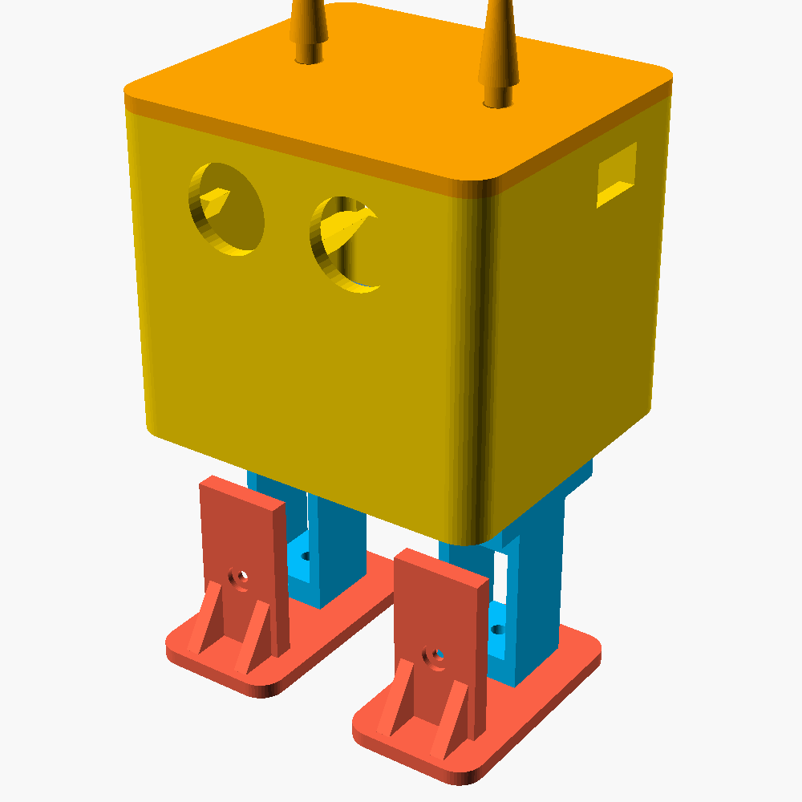
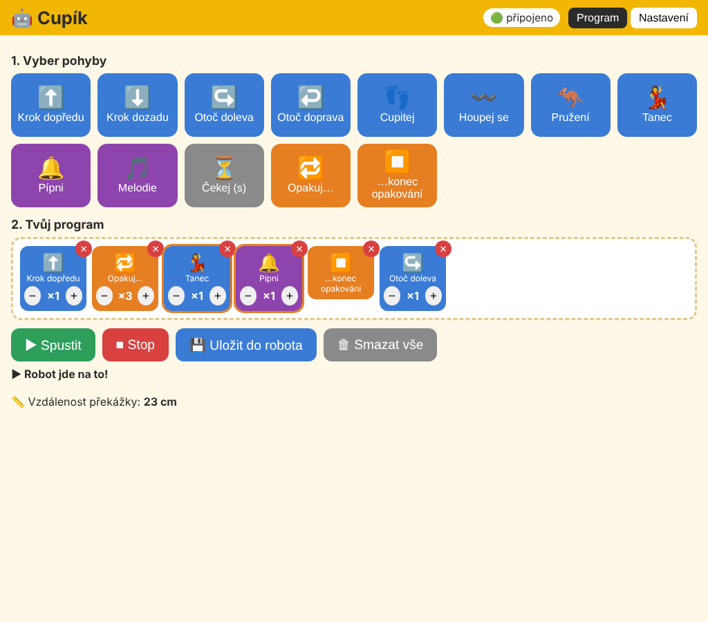

# Cupík – chodící robot pro školy

Malý dvounohý robot, kterého si škola vytiskne na 3D tiskárně a děti ho programují
z tabletu skládáním dlaždic („krok dopředu ×3, opakuj 2× tanec…“).
Starší děti ho můžou programovat v MicroPythonu.



> **Stav: verze 0.1, prototyp.** Model a firmware jsou hotové a otestované v simulaci
> (33 automatických testů), ale **robot zatím nebyl vytištěn ani sestaven**.
> Po prvním tisku bude nejspíš potřeba doladit tolerance a parametry chůze (viz konec návodu).

## Co umí
- Chodí dopředu a dozadu, otáčí se, cupitá, houpe se, pruží a tancuje.
- Pípá a hraje melodii, měří vzdálenost překážky (ultrazvukové „oči“).
- Vlastní Wi-Fi: tablet ani škola nepotřebují internet ani instalaci aplikace.
- Program se uloží do robota a spustí se tlačítkem i bez tabletu.



## Seznam dílů (cca na 1 robota)

| Díl | Ks | Cena cca |
|---|---|---|
| Servo SG90 (180°, ne „360°“!) | 4 | 140 Kč |
| ESP32-C3 SuperMini | 1 | 60 Kč |
| Ultrazvukový senzor HC-SR04 | 1 | 30 Kč |
| Držák 4× AA (plochý, cca 63×58×15 mm) | 1 | 15 Kč |
| Posuvný vypínač SS12D00 | 1 | 2 Kč |
| Schottkyho dioda 1N5822 (3 A) + 1N5819 | 1+1 | 5 Kč |
| Kondenzátor 1000 µF/10 V + 100 nF | 1+1 | 5 Kč |
| Rezistory 1 kΩ, 2 kΩ, 100 Ω | 1+1+1 | 1 Kč |
| Pasivní piezo bzučák | 1 | 5 Kč |
| Kolíkové lišty, dutinková lišta pro ESP32 | – | 10 Kč |
| Deska plošných spojů 68×44 mm (jednostranná) | 1 | ~10 Kč |
| Filament PLA (asi 90 g) | – | 40 Kč |
| **Celkem** | | **≈ 320 Kč** |

K tomu 4× NiMH akumulátor AA (~150 Kč, vydrží roky). **Alkalické baterie raději nepoužívejte:**
čerstvé mají až 6,4 V, což je na hraně pro serva i pro desku ESP32.

## Zapojení

```
 4×AA ──► vypínač ──► D1 1N5822 ──┬──► +V serv (4 konektory + 1 rezerva)
                                  ├──► VCC HC-SR04
                                  ├──► C1 1000 µF + C2 100 nF ──► GND
                                  └──► D2 1N5819 ──► 5V pin ESP32-C3
```

| ESP32-C3 | Připojeno k |
|---|---|
| GPIO3 / GPIO4 | servo kyčel levá / pravá |
| GPIO5 / GPIO6 | servo kotník levý / pravý |
| GPIO7 | rezerva (5. servo: ruka, ocas…) |
| GPIO10 | bzučák (přes 100 Ω) |
| GPIO0 | HC-SR04 TRIG |
| GPIO1 | HC-SR04 ECHO **přes dělič**: 1 kΩ do GPIO1, 2 kΩ z GPIO1 na GND |
| GPIO9 | tlačítko BOOT na desce = spustit/zastavit uložený program |
| GPIO8 | modrá LED na desce (bliká = čeká, svítí = jede program) |

D1 chrání proti otočeným bateriím (děti je tam otočí). D2 brání tomu, aby baterie
tlačily proud do USB počítače, když je robot připojený kabelem.

Konektory serv: hnědá = GND, červená = +V, oranžová = signál.

> Návrh desky plošných spojů v KiCadu (jednostranná, jen součástky s vývody, aby ji
> zapájeli i žáci) je další krok. Do té doby jde vše zapojit na univerzální desce 7×5 cm.

## Tisk

Modely jsou v `stl/`, zdrojový parametrický model v `cad/cupik.scad` (OpenSCAD).

| Díl | Ks | Poznámka |
|---|---|---|
| `telo.stl` | 1 | dnem na podložku, bez podpěr (otvor na baterie vzadu je most 64 mm) |
| `vicko.stl` | 1 | límcem nahoru |
| `noha.stl` | 2 | už otočená vzhůru nohama, bez podpěr |
| `chodidlo.stl` | 2 | podrážkou dolů |
| `tykadlo.stl` | 2 | volitelné, děti si můžou navrhnout vlastní ozdoby do otvorů ve víčku |

PLA, vrstva 0,2 mm, 3 perimetry, výplň 20 %. Na podrážky se hodí nalepit kousek gumy.

Všechny rozměry jdou upravit v OpenSCADu (Okno → Customizer). Před tiskem celé série
**změřte svá serva SG90**: kusy od různých výrobců se liší o desetiny milimetru.
Vygenerování všech STL: `cad/export.sh`.

## Sestavení

1. **Nahrajte firmware a zapněte robota bez nasazených pák.** Serva se po startu nastaví
   do střední polohy. Teprve teď na ně nasaďte páky, aby nohy začínaly rovně.
2. Kyčelní serva vložte shora do těla (hřídelí dolů, k vnějšímu okraji) a přišroubujte úchyty.
3. Jednoramennou páku vložte do kapsy v horní desce nohy a nasaďte nohu na hřídel kyčle.
   Středový šroubek se utahuje šroubovákem skrz otvor zespodu nohy. **Udělejte to dřív, než vložíte kotníkové servo.**
4. Kotníkové servo zasuňte do nohy zepředu a přišroubujte úchyty.
5. Páku vložte do kapsy chodidla, chodidlo nasaďte na hřídel kotníku a přišroubujte zepředu.
6. Elektroniku položte na lišty pod víčkem, „oči“ HC-SR04 zasuňte do otvorů zevnitř.
7. Držák baterií zasuňte jako šuplík zezadu na polici nad serva.

## Firmware

Firmware je v MicroPythonu (`firmware/`).

1. Nahrajte do ESP32-C3 MicroPython (obraz *ESP32_GENERIC_C3* z micropython.org,
   nebo v Thonny → *Instalovat MicroPython*).
2. V Thonny nahrajte do robota obsah složky `firmware/` (soubory `main.py`, `config.py`
   a složky `cupik/` a `www/`).
3. Restartujte robota. Pípne a vytvoří Wi-Fi **Cupik-XXXX** (heslo je v `config.py`,
   výchozí `cupik123`; ve třídě s víc roboty doporučuji heslo změnit a napsat na štítek).
4. Na tabletu se připojte k síti robota a otevřete **http://192.168.4.1**.

### Kalibrace (jednou po sestavení)
V záložce **Nastavení**:
- posuvníky srovnejte nohy, aby stály rovně,
- tlačítkem „+30°“ ověřte směr každého kloubu (kyčel: špička doleva, kotník: chodidlo
  se naklopí doprava při pohledu zepředu). Když jde kloub opačně, klepněte na „Otočit směr“,
- když robot místo dopředu couvá, zaškrtněte „Robot chodí obráceně“.

### Programování v Pythonu (pro starší děti)
```python
from cupik.robot import robot
r = robot()
r.vpred(3)
r.vlevo(2)
for i in range(3):
    r.tanec()
    r.pipni()
if r.vzdalenost() < 15:
    r.vzad(2)
```

### Testy
```
python3 -m unittest discover -s cupik/tests
```

## Co je potřeba ověřit po prvním tisku
- vůle dílů (`tol`) a rozměry serv a pák v `cupik.scad`,
- jestli „oči“ HC-SR04 sedí do otvorů a jestli se do těla vejde zvolený držák baterií,
- parametry chůze v `firmware/cupik/chuze.py` (amplitudy a fáze). Výchozí hodnoty jsou
  rozumný odhad, ale skutečnou chůzi je potřeba vyladit na hotovém robotovi,
- těžiště: když se robot převrací dozadu, prodlužte chodidla (`foot_back`).

## Licence
- Hardware (3D modely, zapojení): **CERN-OHL-S-2.0**
- Software (firmware, aplikace): **MIT**

Viz `LICENSE.md`. Školy můžou robota volně tisknout, upravovat a sdílet.
