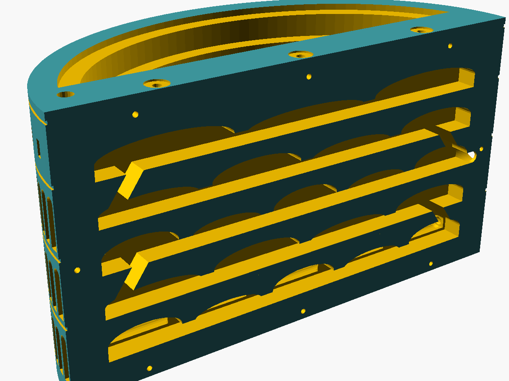

# Mraveniště – evropské památky (3D tisk, Prusa CORE One)

Tři parametrická formikária (mraveniště) ve tvaru památek, navržená v OpenSCADu.
Každý model ukazuje **řez budovou**: vpředu je pozorovací plocha s komůrkami pod
sklem, vzadu „zbytek“ památky. Inspirace: přiložené koncepty (Colosseum / Pyramid
Formicarium).

| Model | Rozměr (Š × H × V) | Díly |
|---|---|---|
| **Koloseum** (Řím) | 230 × 95 × 125 mm | jádro, fasáda, rámeček, víčko, zátky |
| **Parthenón** (Atény) | 236 × 172 × 122 mm | jádro, chrám (sloupy + kladí), střecha, rámeček, víčko, zátky |
| **Šikmá věž** (Pisa) | 95 × 42 × 228 mm | jádro, věž dole, věž nahoře, zvonice, rámeček, víčko, zátky |

Všechny díly se vejdou na **Prusa CORE One / CORE One+ (250 × 220 × 270 mm)**,
tisknou se **bez podpěr** a jsou ověřené jako uzavřená (watertight) tělesa.

| Koloseum | Parthenón | Pisa |
|---|---|---|
|  |  |  |
|  |  |  |

Pohled na komůrky (bez skla): `img/*_core_front.png`.

---

## 1. Co mravenci potřebují a jak to modely řeší

| Potřeba kolonie | Řešení v modelu |
|---|---|
| **Vlhkostní gradient** – vlhká část pro plod, suchá pro zásoby a královnu podle potřeby | Spodní patro má pod komůrkami **6 mm sádry** (kapsy se schůdkem = ryska, kam lít). Sádra je propojená kanálem a zalévá se **akvarijní hadičkou 4/6 mm** shora. Horní patra jsou suchá a větraná → mravenci si sami vyberou. |
| **Plast nedrží vlhkost** (na rozdíl od sádry/Ytongu) | Proto hybridní řešení: plastové tělo + sádrová hydratační zóna. Plast zůstává suchý (méně plísní). |
| **Větrání bez úniku** | Z horních komůrek vedou kanálky Ø 4 mm na horní hranu, kde je zápustné lůžko pro **nerezovou síťku 0,2 mm** (Ø 10 mm). 0,2 mm zadrží i malé nanitiky Lasius (~2 mm). |
| **Správná hloubka komůrek** (mravenci nesmí „lézt po sobě“, ale ani se ztrácet) | Parametr `SPECIES`: 6 / 10 / 15 mm (viz tabulka níže) – odpovídá běžné praxi prodejců (10 mm pro Lasius/Formica, větší pro Camponotus/Messor). |
| **Chodby** | Šířka 4 / 6 / 9 mm podle druhu, galerie na úrovni podlahy, šikmé rampy mezi patry střídavě vlevo/vpravo (kolonie musí projít celé hnízdo – lepší cirkulace a rozdělení pater). |
| **Tma** | Zatemňovací **víčko na magnety** (6×2 mm) s nápisem – sundáš jen při pozorování. Alternativně červená fólie na sklo. |
| **Pozorování** | Plexisklo/sklo 3 mm přitisknuté k rovné čelní ploše (tisk čelem nahoru + žehlení horní vrstvy = rovina bez škvír). |
| **Únikuvzdornost** | Jádro je **jeden kus** (žádné spáry v hnízdě), sklo v drážce rámečku, hrdlo hadičky má vlastní zátku, zavlažovací hadička má zátku. |
| **Aréna (outworld) na krmení a vodu** | Hrdlo pro **silikonovou hadičku 8×12 mm** na boku; aréna = libovolný box s Fluonem (PTFE) na stěnách a víkem se síťkou. Hnízdo samo o sobě arénu nenahrazuje. |
| **Snadná údržba** | Rámeček se sklem jde odšroubovat (M3), sádru lze dovlhčit bez otevírání. |

### Velikost podle druhu (`SPECIES`)

| `SPECIES` | Druhy (příklady) | Hloubka komůrky | Chodba | Výška komůrky |
|---|---|---|---|---|
| `small` | Tetramorium, Temnothorax, Leptothorax, nanitici | 6 mm | 4 mm | 7–9 mm |
| `medium` *(výchozí)* | Lasius niger, Formica, Myrmica, Tapinoma | 10 mm | 6 mm | 10–13 mm |
| `large` | Messor, Camponotus | 15 mm | 9 mm | 14–18 mm |

Předgenerované STL jsou pro **medium** (`stl/medium/`). Jinou velikost vygeneruješ:
```bash
SPECIES=large ./build.sh        # -> stl/large/
```
(Hloubka jádra se mění, proto se přegenerují i fasády – sedí k sobě jen díly stejné velikosti.)

---

## 2. Materiál

| Díl | Materiál | Proč |
|---|---|---|
| **Jádro (hnízdo)** | **PETG** (např. Prusament PETG) | Odolá trvalé vlhkosti; PLA ve vlhku časem degraduje a hůř se čistí. PETG je běžně doporučované pro formikária. |
| Fasády, střecha, zvonice | PETG (nebo PLA – nejsou ve styku s vlhkostí ani mravenci) | PLA „mramor/kámen“ vypadá hezky, PETG je odolnější. |
| Rámeček, víčko | PETG / PLA | – |
| **Nepoužívat** | ABS/ASA (výpary styrenu v uzavřeném prostoru), resin/SLA (nevytvrzené zbytky jsou toxické) | – |

**Barva jádra:** tmavá (černá/hnědá) – mravenci se cítí lépe a lépe je vidět kontrast.

---

## 3. Nastavení tisku (PrusaSlicer, CORE One, tryska 0,4)

| Díl | Vrstva | Perimetry | Výplň | Poznámka |
|---|---|---|---|---|
| `*_core` | 0,2 mm | 4 | 20 % gyroid, 6 horních vrstev | Tiskne se **čelem nahoru**. Zapni **Žehlení → jen nejvyšší plocha** (rovná plocha pod sklo). Žádné podpěry. |
| `*_facade`, `*_temple`, `*_tower_*`, `*_belfry` | 0,15 mm | 3 | 10–15 % gyroid | Stojí tak, jak jsou ve STL. Bez podpěr (jen krátké můstky). Parthenón: pomalejší můstky. |
| `*_roof` | 0,15 mm | 3 | 10 % | plochou stranou dolů |
| `*_bezel` | 0,2 mm | 3 | 30 % | pohledovou stranou na podložku |
| `*_cover` | 0,2 mm | 3 | 20 % | nápis nahoru (lze změnit barvu na vrstvě 2,4 mm = barevný nápis) |
| `*_plugs` | 0,15 mm | 4 | 100 % | |

PETG: 240/85 °C (profil Prusament PETG), na texturovaný plát nebo s lepidlem/separací.

---

## 4. Nákupní seznam (na 1 model)

- PETG ~ 0,3–0,7 kg (dle modelu, fasády jsou plné s řídkou výplní)
- **Plexisklo (PMMA) nebo sklo 3 mm** – rozměr:
  - Koloseum **208 × 105 mm** (obdélník)
  - Pisa **66 × 160 mm** (obdélník)
  - Parthenón **pětiúhelník 184 × 89 mm** → nech vyřezat laserem podle `dxf/parthenon_plate.dxf`
    (DXF pro laser jsou i pro ostatní: `dxf/*_plate.dxf`)
- Šrouby **M3 × 12 zápustné** (samořezné do plastu): Koloseum 8, Parthenón 7, Pisa 4
- Neodymové magnety **6 × 2 mm**: Koloseum 8, Parthenón 8, Pisa 4 (půlka do rámečku, půlka do víčka)
- Nerezová síťka **0,2 mm** (kolečka Ø 10 mm): Koloseum 3, Parthenón 2, Pisa 2
- **Sádra** – modelářská/alabastrová nebo dentální, bez přísad (~50 g)
- **Akvarijní vzduchovací hadička 4/6 mm** (~30 cm)
- **Silikonová hadička 8 × 12 mm** k aréně
- Kousky filamentu 1,75 mm jako **kolíky** (15 mm)
- Lepidlo na spoje mimo hnízdo: vteřinové (CA) nebo 2složkový epoxid
- **Fluon (PTFE)** do arény

---

## 5. Montáž

1. **Tisk** všech dílů. Zkontroluj čelní plochu jádra pravítkem – nesmí být prohnutá.
2. **Zavlažovací hadička:** zasuň hadičku 4/6 mm do otvoru na horní hraně jádra (nejbližší
   kraji) až dolů a do spodního kanálu (jde ohnout), konec ucpi chumáčkem vaty.
3. **Sádra:** jádro polož čelem nahoru, rozmíchej sádru a nalij do spodních (vlhkých) komůrek
   **po schůdek** (6 mm). Sádra proteče kanálem pod příčkami → jedna souvislá vrstva. Nechej
   vytvrdnout 24 h, pak 2–3 dny vysychat.
4. **Větrací síťky** vlep do lůžek na horní hraně (tenká vrstva CA nebo akvarijního silikonu
   jen po obvodu, otvor nezalepit). U Pisy se síťky přitlačí zvonicí.
5. **Fasády:** do otvorů zasuň kolíky z filamentu, slep fasádu (a střechu/zvonici) s jádrem –
   lepidlo jen na vnější styčné plochy, nikdy do komůrek.
6. **Nech všechno min. 48 h větrat** (lepidla, sádra).
7. **Sklo + rámeček:** sklo vlož do drážky rámečku, přišroubuj M3 × 12 (nepřetáhnout).
8. Vlep magnety do rámečku a víčka (pozor na polaritu).
9. **Test těsnosti:** nalij 3–5 ml vody do hadičky, za 1 h zkontroluj, že voda nepronikla mimo
   sádru. Posviť zezadu – skrz spáru mezi sklem a čelem nesmí prosvítat světlo.
10. Do hrdla zasuň hadičku 8 × 12 k aréně (nebo zátku).

### Stěhování kolonie
Kolonie v zkumavce: připoj arénu, zkumavku vlož do arény, hnízdo zatemni víčkem a sádru navlhči.
Mravenci se přestěhují sami (dny až týdny). Hnízdo by nemělo být o moc větší než kolonie –
malé kolonii můžeš horní patra dočasně oddělit/neprovlhčovat, ale hlavně ji nespěchej.

---

## 6. Provoz

- **Zavlažování:** 2–5 ml vody do hadičky 1× týdně (podle druhu a teploty). Sádra má být vlhká,
  **ne mokrá**; kondenzace na skle = moc vody.
- **Gradient:** spodní patro vlhké, horní suché. Nikdy neprovlhčuj celé hnízdo.
- **Teplota:** většina středoevropských druhů 22–26 °C (Messor rád tepleji), mimo přímé slunce.
- **Tma:** víčko nasazené, sundávat jen na pozorování.
- **Čistota:** jídlo jen v aréně. Plíseň v hnízdě = méně vody, víc větrání. Rámeček jde
  odšroubovat a sklo vyčistit (mimo období s plodem).
- **Zimování** (Lasius, Formica, Myrmica…): celé hnízdo s arénou do 5–10 °C, sádra jen lehce vlhká.

---

## 7. Úpravy a generování

Potřebuješ [OpenSCAD](https://openscad.org) (testováno 2021.01).

```bash
./build.sh                                # všechny STL (medium) + DXF skel
SPECIES=small ./build.sh
openscad -D 'PART="core"' -D 'SPECIES="large"' -o core.stl colosseum.scad
```

`PART`: `assembly` (náhled se sklem), `display` (bez skla), `core`, `facade` / `temple` /
`roof` / `tower_lower` / `tower_upper` / `belfry`, `bezel`, `cover`, `plugs`, `plate` (2D → DXF).

Hlavní parametry (`lib/formicarium.scad`): `SPECIES`, `PLASTER_T` (sádra), `PLATE_T`
(sklo), `TUBE_OD` (hadička k aréně), `AIRLINE_OD`, `MESH_D`, rozměry šroubů a magnetů.
V souboru modelu: rozložení pater `COLS` (počet komůrek v každém patře), rozsah pole komůrek
`FIELD_X`, `Z0`, `ZTOP`.

Pro **CORE One L** (300 × 300 × 330) můžeš modely zvětšit úpravou rozměrů v hlavičce
souboru (např. `A`, `B`, `H` u Kolosea) – komůrky zůstanou ve správné velikosti pro druh.

### Kontrola
`build.sh` + kontrola v Pythonu (trimesh): všechny díly jsou uzavřená tělesa z jednoho kusu,
vejdou se do 250 × 220 × 270 mm, plochy s převisem > 45° jsou jen krátké můstky (otvory, horní
hrany nik, kladí mezi hlavicemi sloupů).

---

## Omezení / na co dát pozor

- Modely jsou **stylizované** (Koloseum je pro hnízdo zvýšené), ne přesné repliky.
- Je to **zatím nevytištěný návrh** – ověřeno výpočetně (geometrie, rozměry, převisy).
  Doporučuji nejdřív vytisknout jádro Pisy (nejmenší) a vyzkoušet sádru + těsnost skla.
- Velikosti pro druhy vychází z praxe chovatelů a prodejců, ne z vědeckých norem –
  podle svého druhu případně uprav `CH_D` / `TUN_W`.
- U lepidel a silikonu dodrž dobu vytvrzení a nech hnízdo před nastěhováním vyvětrat.

## Zdroje
- Rozměry tiskárny: [3DJake – Prusa CORE One](https://www.3djake.com/prusa/core-one), [CORE One L](https://www.3djake.com/prusa/core-one-l)
- Šířky mezer podle druhů: [antstore.net – formikária](https://www.antstore.net/shop/en/antfarms---nests), [antstore – akrylová formikária](https://www.antstore.net/shop/en/antfarms---nests/acrylglas-formicaria/)
- Lasius niger velikost: [antstore – Lasius niger](https://www.antstore.net/shop/en/ants/Ants-from-Central-Europe/Lasius-niger--Black-Garden-Ant-.html), [AntCube](https://antcube.shop/en/product/lasius-niger/)
- Vlhkostní gradient, hydratace: [furrycritter – typy formikárií](https://www.furrycritter.com/pages/articles/invertebrates/formicarium_types.htm), [Formiculture – nest humidity](https://www.formiculture.com/topic/2112-nest-humidity-level/)
- PLA vs PETG, plíseň, 3D tisk: [Formiculture – 3D printed nests](https://www.formiculture.com/topic/19064-3d-printed-nests/page-2), [MakerWorld – formicarium (PETG doporučeno)](https://makerworld.com/en/models/3225264-formicarium)
- Větrací síťka 0,2 mm, nanitici: [Formiculture – ventilation for Lasius niger](https://formiculture.com/topic/20022-what-is-the-right-size-for-ventilation-holes-sliths-for-lasius-niger), [antstore – mřížka 0,2 mm](https://www.antstore.net/shop/en/components/grid/grid-insert---27mm---stainless-steel.html)
- Únikuvzdornost, Fluon: [Formiculture – escape prevention](https://formiculture.com/topic/18736-escape-prevention), [AntGear – Fluon](https://antgear.com/?p=510)
