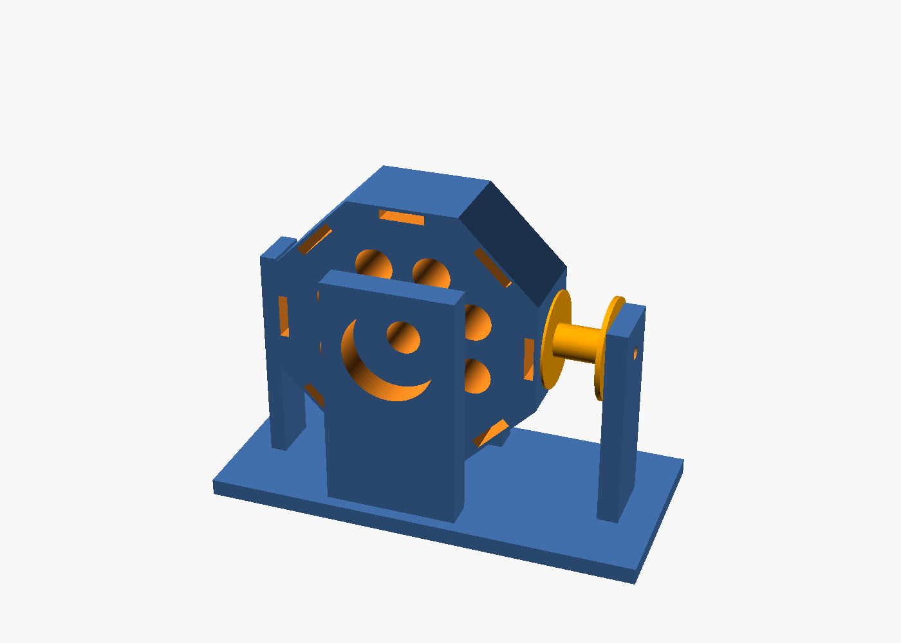
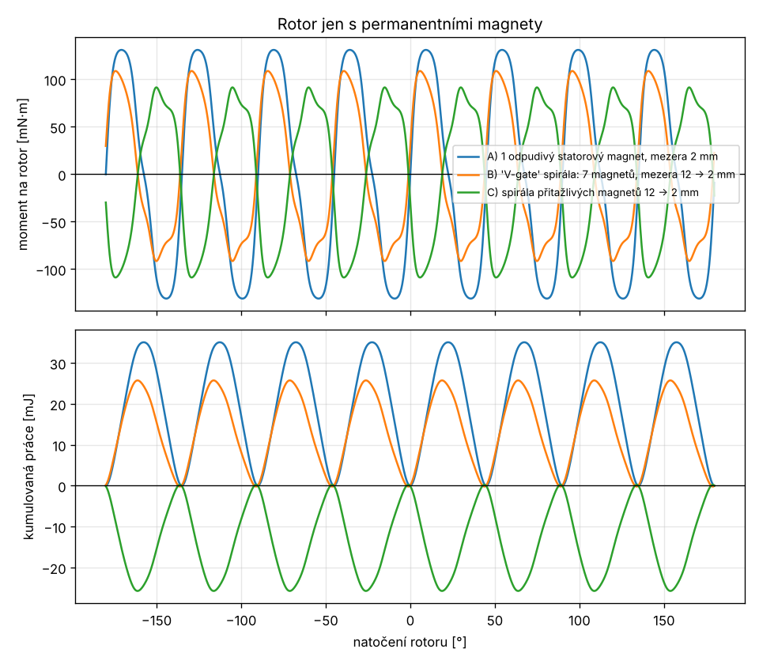
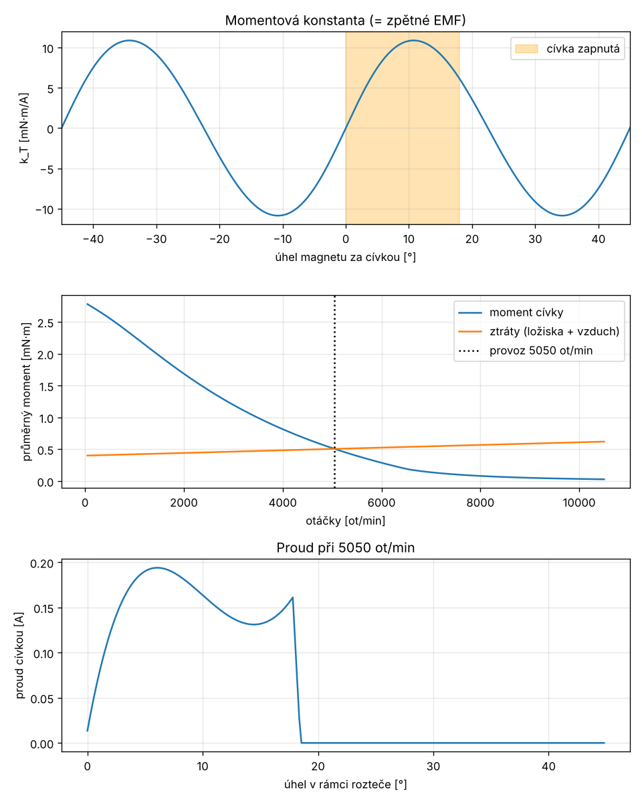

# Zkušební magnetický motor – magnety 20 × 10 × 1,7 mm

Výpočetní model, konstrukce (OpenSCAD) a zapojení malého motoru
poháněného magnetickou silou z neodymových magnetů **20 × 10 × 1,7 mm**.

> **Hlavní závěr výpočtu:** samotné permanentní magnety rotor trvale
> neroztočí. V pevném uspořádání magnetů je čistá práce za jednu otáčku
> přesně nulová. Platí to i pro „V-gate“ a spirálová uspořádání (viz část 1).
> Funkční motor proto potřebuje zdroj energie: **cívku spínanou Hallovou
> sondou** a baterii (viz část 2). Magnety pak dodávají sílu, ale energii
> dodává baterie.



---

## Obsah složky

| Soubor | Účel |
|---|---|
| `magnetostatika.py` | fyzikální jádro: pole magnetů a cívek (Biot–Savart), síly a momenty |
| `motor_model.py` | parametry magnetu, rotoru, cívky, napájení a tření; simulace provozu |
| `spustit.py` | spustí všechny výpočty, vypíše výsledky, uloží grafy do `vystupy/` |
| `test_model.py` | fyzikální kontroly modelu (pytest) |
| `motor.scad` | parametrický 3D model: rotor, stojan, kostra cívky |
| `vystupy/` | grafy a `vysledky.txt` z posledního běhu |

```bash
pip install numpy matplotlib pytest
python3 spustit.py        # ~1,5 minuty
python3 -m pytest -q      # 12 testů, ~5 s
```

## Předpoklady o magnetu

- Rozměr 20 × 10 × 1,7 mm, **zmagnetovaný přes tloušťku** (póly na plochách 20 × 10).
  Tak se tyto magnety běžně prodávají. Ověřte to kompasem nebo druhým magnetem.
- Materiál N42, remanence Br = 1,29 T. Pro N35 změňte `Magnet.br` na 1,18 T, pro N52 na 1,43 T.
- Hmotnost 2,55 g.

| vzdálenost od plochy | 0 mm | 2 mm | 5 mm | 10 mm |
|---|---|---|---|---|
| B na ose [mT] | 149 | 119 | 68 | 26 |

Tenký magnet má na povrchu jen asi 150 mT a jeho pole rychle slábne.
Proto je mezera mezi magnetem a cívkou nejdůležitější rozměr celé konstrukce.

## Jak model počítá

Každý magnet je nahrazen **ekvivalentními povrchovými proudy** (proud
Br·L/μ0 ≈ 1 750 A obtéká boky magnetu). Pole se počítá přesným
Biot–Savartovým vzorcem a síla na každý úsek jako F = I·dl × B. Moment
na rotor je součtem r × F.

Testy ověřují, že:
- pole na ose se shoduje s analytickým vzorcem pro kvádrový magnet na 0,1 %,
- platí akce a reakce mezi dvěma magnety,
- souhlasné póly se odpuzují,
- čistě magnetický rotor nekoná práci za otáčku,
- proud cívky odpovídá Ohmovu zákonu a zpětné EMF ho při vyšších otáčkách snižuje.

---

## 1. Rotor jen s permanentními magnety

Rotor nese 8 magnetů po obvodu (střed magnetu na poloměru 30 mm). Proti
němu stojí pevné „statorové“ magnety. Spočítali jsme tři uspořádání:

| uspořádání | max. moment | max. uložená energie | **práce za otáčku** |
|---|---|---|---|
| A) 1 odpudivý magnet, mezera 2 mm | 131 mN·m | 35 mJ | **≈ 0** (5·10⁻¹⁷ J) |
| B) „V-gate“ spirála 7 magnetů, mezera 12 → 2 mm | 109 mN·m | 26 mJ | **≈ 0** |
| C) spirála přitažlivých magnetů | 109 mN·m | 26 mJ | **≈ 0** |



**Co z toho plyne:** síly jsou velké. Rotor v každé poloze silně táhne
nebo tlačí a v ruce to působí, jako by „chtěl jet“. Kumulovaná práce
(dolní graf) ale vždy nastoupá a pak zase klesne na nulu. Energii, kterou
magnet získá při přibližování, musí vrátit při vzdalování („lepivý bod“).
Magnetostatické pole je konzervativní, takže energie U(θ) je jednoznačná
funkce polohy a práce po uzavřené dráze je nulová. Na geometrii nezáleží.
Ztráty v ložiskích a vzduchu proto rotor bez vnějšího zdroje vždy zastaví.

---

## 2. Funkční zkušební motor: pulzní motor s Hallovou sondou

Princip je stejný jako u bezkomutátorového (BLDC) motoru, jen s jednou
cívkou. Když magnet projde kolem cívky, Hallova sonda sepne tranzistor.
Cívka magnet odpudí a dodá rotoru impulz. Poté se vypne, aby magnet
další cyklus nebrzdila.

### Rozměry (výchozí parametry modelu a `motor.scad`)

| díl | hodnota |
|---|---|
| rotor | osmiboký, PLA, výška 22 mm, 8 magnetů, **jižní pól ven** (kvůli sondě A3144), střed magnetu na R = 30 mm |
| kapsa magnetu | 10,5 × 20,5 × 2,2 mm, vnější stěna 0,8 mm |
| cívka | vzduchová, vnitřní Ø 8 mm, vnější Ø 22 mm, délka vinutí 12 mm |
| vinutí | **≈ 580 závitů CuL Ø 0,30 mm**, cca 27 m drátu, R ≈ 6,7 Ω, L ≈ 2,7 mH |
| mezera | 2,5 mm od plochy magnetu k vinutí (stěna 0,8 + vůle 0,85 + čelo kostry 0,6) |
| ložiska | 2 × 608ZZ, hřídel M8 |
| napájení | 6 V (4 × AA) |

### Vypočtené výsledky (6 V)

| veličina | hodnota |
|---|---|
| špičková momentová konstanta k_T | 10,9 mN·m/A (10,7° za úvratí) |
| proud při stojícím rotoru | 0,89 A |
| rozběhový moment | ≈ 9,6 mN·m (špička), ≈ 3 mN·m průměrně |
| **optimální spínací okno** | **zapnout v úvrati (0°), vypnout 18° za ní** |
| **ustálené otáčky naprázdno** | **≈ 5 000 ot/min** |
| příkon z baterie | ≈ 0,36 W (průměrně 60 mA) |
| výkon spotřebovaný třením | ≈ 0,27 W (účinnost naprázdno ≈ 75 %) |
| roztočení na 90 % otáček | ≈ 20 s |
| výdrž 4 × AA | ≈ 40 h |
| odstředivá síla na 1 magnet | ≈ 21 N |



**Citlivost (stejné okno 0–18°):**

| varianta | otáčky | příkon |
|---|---|---|
| základ 6 V | 5 050 ot/min | 0,36 W |
| **bez Zenerovy diody** (jen nulová dioda) | 3 400 ot/min | 0,93 W |
| 3,7 V (1 Li-ion článek) | 2 800 ot/min | 0,21 W |
| 9 V | 7 900 ot/min | 0,59 W ⚠ odstředivá síla 2,4× větší |
| tření 2× menší | 6 100 ot/min | 0,20 W |
| tření 2× větší | 3 600 ot/min | 0,65 W |

Nejistý vstup je tření. Model počítá s 0,4 mN·m pro dvě ložiska 608ZZ
plus odpor vzduchu. Skutečné otáčky proto mohou vyjít o desítky procent
jinak. Trend a poměry mezi variantami ale platí.

**Proč Zenerova dioda:** model ukázal, že s obyčejnou nulovou diodou přes
cívku indukuje každý přibližující se magnet v cívce napětí až 4 V. Dioda
toto napětí zkratuje, cívka pak pracuje jako generátor a motor brzdí.
Otáčky klesnou o třetinu a spotřeba se ztrojnásobí. Zenerova dioda 15 V
v sérii s diodou tento proud zablokuje. Zároveň rychle vybije energii
cívky při vypnutí.

### Zapojení

```
                       +6 V
   ┌─────────┬───────────┼──────────────┬──────────────┐
   │         │           │              │              │
 [10k]     [4k7]      ┌──┴──┐       ZD 15 V          ═╧═  100 µF
   │         │        │CÍVKA│      (anoda nahoře)      │
   ├── OUT   │        │580 z│           │             GND
   │  A3144  ├── G    └──┬──┘     1N4007 (katoda nahoře)
 [10k]       │  IRLZ44N  │              │
   │         C   D ──────┴──────────────┘
   B  BC547      S
     E           │
     │           │
    GND         GND          A3144: Vcc → +6 V, GND → GND
```

1. **A3144** (unipolární Hallova sonda) má výstup s otevřeným kolektorem.
   Když je u sondy jižní pól magnetu, je výstup v log. 0, jinak ho pull-up 10 k drží v log. 1.
2. **BC547** obrací logiku. Bez magnetu vede a drží gate MOSFETu na zemi.
   Při magnetu u sondy se zavře a gate vytáhne odpor 4k7 na +6 V.
3. **IRLZ44N** (logický MOSFET) spíná cívku proti zemi.
4. Nulová větev: **drain → 1N4007 (anoda→katoda) → Zenerova dioda 15 V
   (katoda→anoda) → +6 V**. Omezuje napěťovou špičku při vypnutí na ~22 V.
   MOSFET snese 55 V.
5. Kondenzátor 100 µF přímo u cívky pokryje proudové špičky.

### Umístění a ladění Hallovy sondy

- Sonda je na sloupku **naproti cívce (180°)**. Rozteč magnetů je 45°,
  takže 180° jsou přesně 4 rozteče a sonda „vidí“ stejnou fázi jako cívka.
- Sonda sepne, už když se magnet blíží, a vypne až za ním. Okno je zhruba
  souměrné kolem polohy sondy a široké asi jako magnet (cca 15–20°).
  Aby okno začínalo v úvrati, posuňte sondu o **~9° po směru otáčení**.
  Na poloměru 32 mm je to asi 5 mm. Slouží k tomu svislá drážka ve sloupku.
  Směr otáčení určuje právě toto posunutí.
- Postup: motor roztočte rukou ve směru, ve kterém má běžet. Posouvejte
  sondu, dokud otáčky (měřte mobilem stroboskopem nebo fotozávorou) a
  proud (multimetrem) nejsou co nejlepší. Při špatném nastavení motor
  „cuká“ nebo se točí opačně.
- Přesnější alternativa: sondu čte Arduino nebo ATtiny a cívku spíná se
  zpožděním podle aktuálních otáček.

### Seznam materiálu

| ks | položka |
|---|---|
| 8 (+2 rezerva) | magnet NdFeB 20 × 10 × 1,7 mm (N35–N52) |
| ~30 m | lakovaný Cu drát Ø 0,30 mm (stačí cívka 50 g) |
| 2 | ložisko 608ZZ (lépe s odstraněným tukem nebo krytem: menší tření) |
| 1 | závitová tyč M8 × 80 mm + 4 matice |
| 1 | Hallova sonda A3144 (nebo jiná unipolární, reaguje na jižní pól) |
| 1 | MOSFET IRLZ44N |
| 1 | tranzistor BC547 |
| 1 + 1 | dioda 1N4007, Zenerova dioda 15 V / 1 W |
| 2 + 1 | rezistor 10 k, 4k7 |
| 1 | kondenzátor 100 µF / 16 V |
| 1 | držák 4 × AA s vypínačem |
| – | 3D tisk PLA: `motor.scad` (`dil = "rotor"`, `"stojan"`, `"civka"`) |

### Postup stavby

1. Vytiskněte díly. Rotor tiskněte s osou svisle, 100% výplní u stěn a se 4 perimetry.
2. **Polaritu magnetů** určete podle sondy A3144: jižní pól ven sondu sepne
   (LED na výstupu). Všechny magnety musí mířit ven **stejným pólem**.
   Lepte je kyanoakrylátem nebo epoxidem. Nejlépe přes celý obvod
   ještě omotejte 2–3 vrstvy pásky nebo vlákna.
3. Naviňte cívku (cca 580 závitů, pečlivě vedle sebe). Změřte odpor:
   měl by být 6–7 Ω. Při výrazně nižším odporu přidejte závity.
4. Vyvažte rotor: má volně dotočit bez kývání do jedné polohy.
5. Zkontrolujte polaritu cívky. Když na ni krátce přivedete 6 V, musí
   magnet **odpuzovat**. Pokud ho přitahuje, prohoďte vývody.
6. Zapojte elektroniku, roztočte rukou a dolaďte polohu sondy.

### Bezpečnost

- Při 5 000 ot/min působí na každý magnet odstředivá síla ~21 N (2 kg).
  Uvolněný magnet letí rychlostí ~16 m/s. **Používejte ochranné brýle a
  kryt.** Nad 6 V napájení rotor vždy navíc obvodově zpevněte.
- Neodymové magnety jsou křehké. Při nárazu na sebe se tříští na ostré úlomky.
  Nepatří do blízkosti kardiostimulátorů ani do dosahu dětí (nebezpečí při spolknutí).
- Cívka se při zablokovaném rotoru zahřívá (0,9 A, 5 W). Nenechávejte
  motor stát pod proudem.

---

## Co zkusit dál (stačí změnit parametry v `motor_model.py`)

- **Silnější motor:** železné jádro v cívce (šroub M4 nebo ferit) zvýší
  k_T asi 2–3×. Přidá ale kroutivý moment (cogging): rotor se „lepí“ k jádru.
  Za otáčku i ten dá nulovou práci, jen ho cívka musí překonat.
- **Druhá cívka** naproti první (180°) zdvojnásobí moment.
  Sondu pak posuňte o 90° (2 rozteče).
- **Střídavé póly** (S, J, S, J…) se dvěma sondami a H-můstkem umožní
  tlačit i táhnout. Jde o skutečný jednofázový BLDC.
- **Generátorový pokus:** roztočte rotor rukou a měřte napětí na cívce.
  Amplituda U = k_T · ω odpovídá křivce k_T z grafu výše a ověří model.
