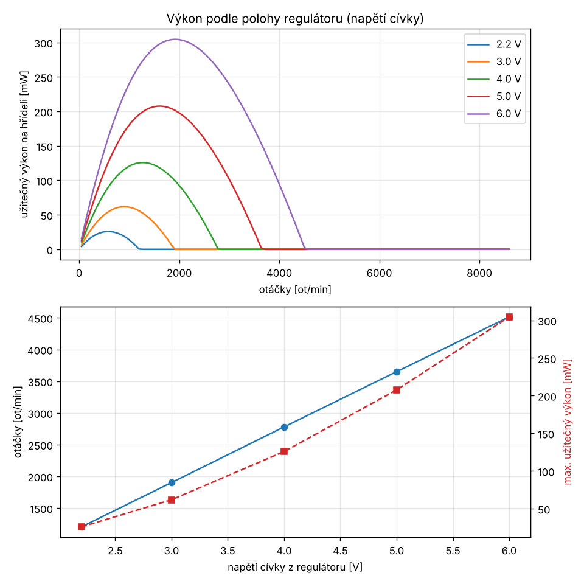

# Zkušební magnetický motor – magnety 20 × 10 × 2 mm

Výpočetní model, konstrukce (OpenSCAD), zapojení s regulátorem otáček a
nákupní seznam pro malý motor poháněný magnetickou silou z neodymových
magnetů **20 × 10 × 2 mm (N50)**.

> **Hlavní závěr výpočtu:** samotné permanentní magnety rotor trvale
> neroztočí. V pevném uspořádání magnetů je čistá práce za jednu otáčku
> přesně nulová. Platí to i pro „V-gate“ a spirálová uspořádání (viz část 1).
> Funkční motor proto potřebuje zdroj energie: **cívku spínanou Hallovou
> sondou** a baterii (viz část 2). Magnety pak dodávají sílu, ale energii
> dodává baterie.


---

## Obsah složky

| Soubor | Účel |
|---|---|
| `magnetostatika.py` | fyzikální jádro: pole magnetů a cívek (Biot–Savart), síly a momenty |
| `motor_model.py` | parametry magnetu, rotoru, cívky, napájení a tření; simulace provozu a výkonu |
| `spustit.py` | spustí všechny výpočty, vypíše výsledky, uloží grafy do `vystupy/` |
| `test_model.py` | fyzikální kontroly modelu (pytest) |
| `motor.scad` | parametrický 3D model: rotor, stojan, kostra cívky |
| `nakupni-seznam.xlsx` | nákupní seznam s odkazy do obchodů |
| `vystupy/` | grafy a `vysledky.txt` z posledního běhu |

```bash
pip install numpy matplotlib pytest
python3 spustit.py        # ~2 minuty
python3 -m pytest -q      # 12 testů, ~5 s
```

## Předpoklady o magnetu

- Rozměr 20 × 10 × 2 mm, **zmagnetovaný přes tloušťku** (póly na plochách 20 × 10).
- Materiál N50 (Hadex P801), remanence Br = 1,42 T. Pro N38 (např. Unimagnet)
  změňte `Magnet.br` na 1,23 T, výsledky jsou v citlivostním rozboru.
- Hmotnost 3,0 g. **Nekupujte samolepicí verzi**, vrstva lepidla zvětší mezeru.

| vzdálenost od plochy | 0 mm | 2 mm | 5 mm |
|---|---|---|---|
| B na ose [mT] | 190 | 151 | 85 |

Pole magnetu rychle slábne se vzdáleností. Proto je mezera mezi magnetem
a cívkou nejdůležitější rozměr celé konstrukce.

## Jak model počítá

Každý magnet je nahrazen **ekvivalentními povrchovými proudy** (proud
Br·L/μ0 obtéká boky magnetu). Pole se počítá přesným Biot–Savartovým
vzorcem a síla na každý úsek jako F = I·dl × B. Moment na rotor je
součtem r × F. Proud v cívce se počítá z rovnice RL obvodu včetně zpětného
EMF a spínací logiky.

Testy ověřují, že:
- pole na ose se shoduje s analytickým vzorcem pro kvádrový magnet na 0,1 %,
- platí akce a reakce mezi dvěma magnety,
- souhlasné póly se odpuzují,
- čistě magnetický rotor nekoná práci za otáčku,
- proud cívky odpovídá Ohmovu zákonu a zpětné EMF ho při vyšších otáčkách snižuje.

---

## 1. Rotor jen s permanentními magnety

Rotor nese 8 magnetů po obvodu (střed magnetu na poloměru 30 mm). Proti
němu stojí pevné „statorové“ magnety. Spočítali jsme tři uspořádání:

| uspořádání | max. moment | max. uložená energie | **práce za otáčku** |
|---|---|---|---|
| A) 1 odpudivý magnet, mezera 2 mm | 205 mN·m | 54 mJ | **≈ 0** (2·10⁻¹⁷ J) |
| B) „V-gate“ spirála 7 magnetů, mezera 12 → 2 mm | 168 mN·m | 40 mJ | **≈ 0** |
| C) spirála přitažlivých magnetů | 168 mN·m | 40 mJ | **≈ 0** |


**Co z toho plyne:** síly jsou velké. Rotor v každé poloze silně táhne
nebo tlačí a v ruce to působí, jako by „chtěl jet“. Kumulovaná práce
(dolní graf) ale vždy nastoupá a pak zase klesne na nulu. Energii, kterou
magnet získá při přibližování, musí vrátit při vzdalování („lepivý bod“).
Magnetostatické pole je konzervativní, takže energie U(θ) je jednoznačná
funkce polohy a práce po uzavřené dráze je nulová. Na geometrii nezáleží.
Ztráty v ložiskích a vzduchu proto rotor bez vnějšího zdroje vždy zastaví.

---

## 2. Funkční zkušební motor: pulzní motor s Hallovou sondou

Princip je stejný jako u bezkomutátorového (BLDC) motoru, jen s jednou
cívkou. Když magnet projde kolem cívky, Hallova sonda sepne tranzistor.
Cívka magnet odpudí a dodá rotoru impulz. Poté se vypne, aby magnet
další cyklus nebrzdila. **Otáčky se regulují napětím cívky** z
nastavitelného měniče (část 3).

### Rozměry (výchozí parametry modelu a `motor.scad`)

| díl | hodnota |
|---|---|
| rotor | osmiboký, PLA, výška 22 mm, 8 magnetů, **jižní pól ven** (kvůli sondě A3144), střed magnetu na R = 30 mm |
| kapsa magnetu | 10,5 × 20,5 × 2,5 mm, vnější stěna 0,8 mm |
| cívka | vzduchová, vnitřní Ø 8 mm, vnější Ø 22 mm, délka vinutí 12 mm |
| vinutí | **≈ 580 závitů CuL Ø 0,30 mm**, cca 27 m drátu, R ≈ 6,7 Ω, L ≈ 2,7 mH |
| mezera | 2,5 mm od plochy magnetu k vinutí (stěna 0,8 + vůle 0,85 + čelo kostry 0,6) |
| ložiska | 2 × 608ZZ, hřídel M8 |
| napájení | 6 × AA (9 V) → regulátor → cívka 2,2–6,0 V |

### Vypočtené výsledky (regulátor na maximu, cívka 6 V)

| veličina | hodnota |
|---|---|
| špičková momentová konstanta k_T | 13,6 mN·m/A (10,7° za úvratí) |
| proud při stojícím rotoru | 0,89 A |
| rozběhový moment | ≈ 12 mN·m (špička) |
| **optimální spínací okno** | **zapnout v úvrati (0°), vypnout 18° za ní** |
| **otáčky naprázdno** | **≈ 4 500 ot/min** |
| odběr z baterie naprázdno | ≈ 0,40 W, výdrž 6 × AA ≈ 55 h |
| roztočení na 90 % otáček | ≈ 15 s |
| odstředivá síla na 1 magnet | ≈ 20 N |


**Citlivost (stejné okno 0–18°, 6 V):**

| varianta | otáčky naprázdno | příkon cívky |
|---|---|---|
| základ (N50) | 4 500 ot/min | 0,29 W |
| **bez Zenerovy diody** (jen nulová dioda) | 2 900 ot/min | 0,92 W |
| magnety N38 | 4 900 ot/min | 0,33 W |
| tření 2× menší | 5 200 ot/min | 0,17 W |
| tření 2× větší | 3 500 ot/min | 0,53 W |

Slabší magnety (N38) mají vyšší otáčky naprázdno, protože indukují menší
zpětné napětí. Pod zátěží ale dají menší moment.

Nejistý vstup je tření. Model počítá s 0,4 mN·m pro dvě ložiska 608ZZ
plus odpor vzduchu. Skutečné otáčky proto mohou vyjít o desítky procent
jinak. Trend a poměry mezi variantami ale platí.

**Proč Zenerova dioda:** s obyčejnou nulovou diodou přes cívku indukuje
každý přibližující se magnet v cívce napětí, které dioda zkratuje. Cívka
pak pracuje jako generátor a motor brzdí. Zenerova dioda 15 V v sérii
s diodou tento proud zablokuje a zároveň rychle vybije energii cívky
při vypnutí.

---

## 3. Regulátor otáček a výkon

### Jak regulace funguje

Logika (Hallova sonda, tranzistory) běží přímo z baterie 9 V. Cívka dostává
napětí ze **step-down měniče LM2596**, jehož trimr je nahrazen **panelovým
potenciometrem 1 kΩ** se sériovým odporem **270 Ω**. Výstup měniče je
U = 1,23 V · (1 + R2/330 Ω), takže rozsah je asi **2,2–6,0 V**. Sériový
odpor tak zároveň hlídá horní mez otáček, aby odstředivá síla nepřekročila
bezpečnou hodnotu.

Proč ne PWM modul pro DC motory: ten spíná minus pól zátěže, takže by
nespolupracoval s vlastním spínačem cívky (MOSFET) a Hallovou sondou.

### Kolik výkonu model dá

Užitečný výkon je výkon na hřídeli, který zbude po odečtení tření.
Maximum má motor zhruba v polovině otáček naprázdno, kdy je zatížený
(například brzděný nebo pohánějící malý ventilátor či generátor).

| regulátor (napětí cívky) | otáčky naprázdno | **max. užitečný výkon** | při otáčkách | moment | odběr z baterie |
|---|---|---|---|---|---|
| 2,2 V (minimum) | 1 200 ot/min | 26 mW | 570 ot/min | 0,43 mN·m | 0,27 W |
| 3,0 V | 1 900 ot/min | 62 mW | 910 ot/min | 0,65 mN·m | 0,42 W |
| 4,0 V | 2 800 ot/min | 126 mW | 1 290 ot/min | 0,93 mN·m | 0,66 W |
| 5,0 V | 3 650 ot/min | 208 mW | 1 620 ot/min | 1,22 mN·m | 0,96 W |
| **6,0 V (maximum)** | **4 500 ot/min** | **≈ 0,3 W** | **1 900 ot/min** | **1,5 mN·m** | **1,3 W** |



**Pro představu:** 0,3 W stačí zvednout 100 g o 30 cm za sekundu nebo
roztočit malý ventilátorek. Motor je to tedy slabý, ale měřitelný.
Účinnost cívky je při maximálním výkonu asi 28 %. Zbytek se mění v teplo
ve vinutí, protože vzduchová cívka s 2,5mm mezerou využívá jen malou část
pole magnetu.

Výkon roste zhruba se čtvercem napětí. Větší výkon dají: více cívek,
menší mezera, železné jádro nebo silnější (tlustší) magnety. Viz „Co zkusit dál“.

---

## 4. Zapojení

```
 BATERIE 6×AA (9 V)
   (+)──[POJISTKA 1 A]──[VYPÍNAČ]──┬─────────────── +9 V (logika) ─────────────────┐
   (−)─────────────────────────────│──┬──── GND (společná zem) ────────────────┐   │
                                   │  │                                        │   │
                             ┌─────┴──┴─────┐                                  │   │
                             │ LM2596       │  trimr nahrazen:                 │   │
                             │ IN+  IN−     │  POT 1 kΩ + 270 Ω v sérii        │   │
                             │ OUT+ OUT−────┼─── GND                           │   │
                             └──┬───────────┘                                  │   │
                                │ +UC (2,2–6,0 V)                              │   │
              ┌─────────────────┼──────────────┐                               │   │
            ═══╧═══ 100 µF   ┌──┴──┐       ZD 15 V (anoda k +UC)               │   │
              │              │CÍVKA│            │ (katoda)                     │   │
             GND             │580 z│        1N4007 (katoda nahoru)             │   │
                             └──┬──┘            │ (anoda)                      │   │
                                └── D ──────────┘                              │   │
                               IRLZ44N   S ── GND                              │   │
                                         G ──┬── [4k7] ── +9 V                 │   │
                                             └── C  BC547   E ── GND           │   │
                                                    B ── [10k] ──┐             │   │
                                                                 │             │   │
   +9 V ── [10k] ──────────────────────────────────────────────── OUT A3144    │   │
   +9 V ── [2k2] ── LED ─────────────────────────────────────────┘ (Vcc +9 V, GND)
```

1. **Pojistka 1 A a vypínač** hned u baterie. 6 × AA dokáže při zkratu dodat několik ampér.
2. **Logika z 9 V:** A3144 (Vcc +9 V), pull-up 10 k, BC547 přes 10 k do báze.
   Gate IRLZ44N má pull-up 4k7 na +9 V (Vgs 9 V, IRLZ44N snese 16 V).
3. **Kontrolka LED s 2k2** svítí, když je u sondy magnet. Velmi usnadní ladění polohy sondy.
4. **Cívka** visí mezi +UC (výstup regulátoru) a drainem MOSFETu.
5. **Nulová větev:** drain → 1N4007 (anoda→katoda) → Zenerova dioda 15 V
   (katoda→anoda) → +UC. Špička při vypnutí je nejvýše ~22 V, MOSFET snese 55 V.
6. **100 µF** přímo u cívky mezi +UC a GND.
7. Všechny země (baterie −, IN− a OUT− měniče, emitor BC547, source MOSFETu, GND sondy) spojte do jednoho bodu.

**Úprava měniče:** odpájejte modrý trimr (10 kΩ). Na jeho místo (střední
vývod + jeden krajní) připojte sériově potenciometr 1 kΩ a odpor 270 Ω.
**Před připojením cívky** změřte multimetrem rozsah výstupu. Měl by být
asi 2,2–6,0 V. Pokud je na vašem modulu jiný dolní odpor než 330 Ω,
rozsah se posune, hodnotu 270 Ω pak upravte.

**Na první zkoušky** postačí nepájivé pole a propojky. Cívku, napájení a
MOSFET ale připojte lankem 0,5 mm², tenké propojky na 1 A nejsou stavěné.

### Umístění a ladění Hallovy sondy

- Sonda je na sloupku **naproti cívce (180°)**. Rozteč magnetů je 45°,
  takže 180° jsou přesně 4 rozteče a sonda „vidí“ stejnou fázi jako cívka.
- Sonda sepne, už když se magnet blíží. Aby okno začínalo v úvrati,
  posuňte ji o **~9° po směru otáčení** (asi 5 mm). Slouží k tomu svislá drážka ve sloupku.
  Směr otáčení určuje právě toto posunutí.
- Ladění: regulátor dejte asi na 4 V, roztočte rotor rukou a posouvejte
  sondu, dokud nejsou otáčky (měřte stroboskopem v mobilu) co nejvyšší.

### Postup stavby

1. Vytiskněte díly z `motor.scad` (`dil = "rotor"`, `"stojan"`, `"civka"`).
   Rotor tiskněte s osou svisle a se 4 perimetry.
2. **Polaritu magnetů** určete podle sondy A3144 a LED: jižní pól ven ji rozsvítí.
   Všechny magnety musí mířit ven **stejným pólem**. Lepte je epoxidem nebo
   kyanoakrylátem a přes obvod omotejte 2–3 vrstvy pásky.
3. Naviňte cívku (cca 580 závitů, pečlivě vedle sebe). Konce drátu
   obruste nebo opalte a pocínujte. Změřte odpor: měl by být 6–7 Ω.
4. Vyvažte rotor: má volně dotočit bez kývání do jedné polohy.
5. Upravte a nastavte měnič (viz výše) **ještě bez cívky**.
6. Zkontrolujte polaritu cívky. Když na ni krátce přivedete napětí, musí
   magnet **odpuzovat**. Pokud ho přitahuje, prohoďte vývody.
7. Zapojte vše, regulátor dejte na minimum, roztočte rukou a dolaďte sondu.

### Bezpečnost

- Při 4 500 ot/min působí na každý magnet odstředivá síla ~20 N (2 kg).
  Uvolněný magnet letí rychlostí ~14 m/s. **Používejte ochranné brýle a kryt.**
  Odpor 270 Ω v regulátoru nenahrazujte zkratem: drží maximum na 6 V.
- Neodymové magnety jsou křehké. Při nárazu na sebe se tříští na ostré úlomky.
  Nepatří do blízkosti kardiostimulátorů ani do dosahu dětí (nebezpečí při spolknutí).
- Cívka se při zablokovaném rotoru zahřívá (0,9 A, 5 W). Nenechávejte
  motor stát pod proudem.

---

## Co zkusit dál (stačí změnit parametry v `motor_model.py`)

- **Silnější motor:** železné jádro v cívce (šroub M4 nebo ferit) zvýší
  k_T asi 2–3×. Přidá ale kroutivý moment (cogging): rotor se „lepí“ k jádru.
  Za otáčku i ten dá nulovou práci, jen ho cívka musí překonat.
- **Druhá cívka** naproti první (180°) zdvojnásobí moment.
  Sondu pak posuňte o 90° (2 rozteče).
- **Střídavé póly** (S, J, S, J…) se dvěma sondami a H-můstkem umožní
  tlačit i táhnout. Jde o skutečný jednofázový BLDC.
- **Generátorový pokus:** roztočte rotor rukou a měřte napětí na cívce.
  Amplituda U = k_T · ω odpovídá křivce k_T z grafu výše a ověří model.
