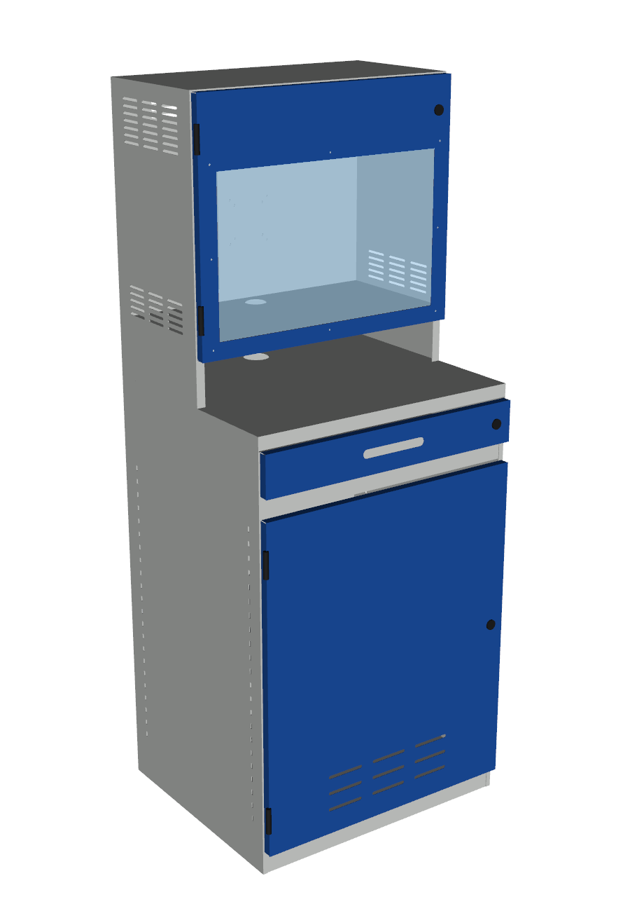

# Plechová PC skříň s monitorovou nástavbou

Parametrický model průmyslové PC skříně (inspirace: stojací počítačová skříň
650 × 550 × 1650 mm). Svařovaný korpus z ocelového plechu, dveře a zásuvka montované.



## Rozměry a uspořádání (zdola nahoru)
| Část | Z [mm] | Popis |
|---|---|---|
| Sokl | 0–50 | ohnuté dno se soklem |
| Skříňka na PC | 50–828 | dveře 770 mm, zámek, 1 stavitelná police (rozteč 32 mm), větrání v zádech a dveřích |
| Zásuvka na klávesnici | 868–970 | čelo 96 mm, zámek, teleskopické pojezdy 400 mm |
| Pracovní deska | 1000 | průchodka kabelů Ø60 |
| Otevřená nika | 1000–1130 | odkládací prostor pod monitorem |
| Skříňka na monitor | 1130–1650 | hloubka 320 mm, prosklená dvířka (okno 560 × 350), zámek, VESA 75/100, větrací žaluzie |

- Monitor: 540 × 330 mm, hloubka do 200 mm na VESA držáku, střed obrazovky ve výšce ~1315 mm.
- Volná plocha pracovní desky před monitorovou skříňkou: 650 × 230 mm (myš, čtečka).

## Materiál a výroba
- Korpus: DC01 **1,5 mm**, svařovaný; dveře, čelo, vana zásuvky: DC01 **1,0 mm**; police pozink 1,0 mm; držák VESA 2,0 mm.
- Zasklení: polykarbonát 4 mm, uchycení na 8 přivařovacích/nalisovaných svornících M4 (otvory Ø4,2 ve dveřích).
- Ohyby: vnitřní R = tloušťka plechu, **K‑faktor 0,44**, všechny ohyby 90°.
- Povrch: prášková barva RAL 7035 (korpus) / RAL 5010 (dveře, čelo).
- Hmotnost plechových dílů ≈ 62 kg.
- Nakupované díly: 4× přivařovací pant, 3× vačkový zámek Ø20, 1 pár teleskopických pojezdů 400 mm, příchytky police.

## Soubory (`vystup/`)
| Soubor | Obsah |
|---|---|
| `pc_skrin_sestava.step` | 3D sestava (otevře Shapr3D, Fusion, FreeCAD, SolidWorks) |
| `dxf/*.dxf` | rozvinuté plechy 1:1 v mm; vrstvy `CUT` (obrys, otvory), `BEND` (osa ohybu), `TEXT` |
| `kusovnik.csv` | kusovník: materiál, tloušťka, rozvin, hmotnost |
| `nahled_*.png` | náhledy (zavřeno, bez dveří, zezadu, ukázka rozvinu) |

Rozviny mají pravoúhlé rohové výřezy (relief). Rohy korpusu se po ohnutí zavaří a zabrousí.
**Před výrobou ověřte K‑faktor a poloměr ohybu s vaší ohraňovnou.** Pokud se liší, změňte
`K_FACTOR` v `sheetmetal.py` a model přegenerujte.

## Přegenerování
```bash
pip install cadquery
python3 cabinet.py   # STEP, DXF, kusovník + kontrola kolizí
python3 render.py    # náhledy (vyžaduje VTK s EGL/OSMesa)
```
Rozměry a polohy se mění v konstantách na začátku `cabinet.py`.
